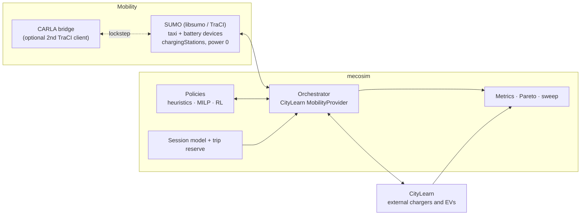
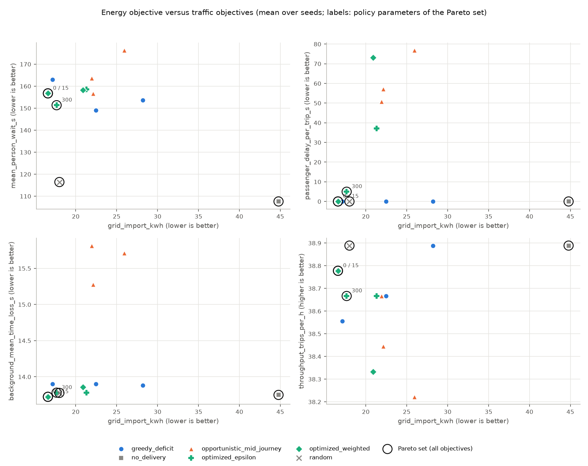

# mobility-energy-cosim (`mecosim`)

Co-simulation of automated electric vehicles (AVs) that carry energy across a city: they charge where solar power is
plentiful and deliver it, by vehicle-to-building discharge, where it is scarce, sometimes mid-journey with passengers
on board. mecosim couples [SUMO](https://eclipse.dev/sumo/) (traffic, taxis, passengers, battery) with
[CityLearn](https://github.com/citylearn-project/CityLearn) (buildings, PV, chargers, KPIs), models the real duration
of an automated energy stop, and compares dispatch policies on energy objectives **and** traffic objectives with Pareto
analysis, so that planning choices can be judged "for the greater good" rather than on one metric.

## Why

An automated fleet could move solar energy from PV-rich to PV-poor parts of a city. Whether that helps depends on
things single-domain models leave out: an automated stop has 77 s without energy flow (robotic coupling 24 s,
communication start-up 27 s, set-point delay 4 s, decoupling 22 s), small deliveries pay that overhead proportionally
more, passengers on board are delayed, curbside stops block lanes, and each vehicle must keep enough energy to finish
its trip. mecosim makes those trade-offs explicit and measurable:

- a **session model** with cited phase timings, closed-form energy over any interval and the exact inverse ("how long
  must the vehicle stop to deliver E kWh");
- the **energy per stop as a decision variable** (e.g. 1 kWh instead of a fixed 5 kWh), enforced exactly in CityLearn
  through the session's discharge floor, chosen by heuristics, a rolling-horizon **MILP** (`scipy.optimize.milp`,
  HiGHS) or an RL agent;
- a **trip-energy reserve** from route lengths and a conservative consumption estimate;
- **mobility metrics** (throughput, waiting and travel times, passenger delay from energy stops, background time loss,
  energy-delivery vehicle-km) next to **energy metrics** (grid import, peak, emissions, deficit served, PV
  self-consumption, battery cycles), with **Pareto sets** (pymoo) and an **ε-constraint** frontier.

## Architecture



The CityLearn step is the master step (60 s in the demo); SUMO advances in its own steps (1 s, or 0.05 s with CARLA)
inside `MobilityProvider.update`, one interval ahead of the energy model, so arrivals and departures within an interval
are known before its energy is computed. Energy is counted once: SUMO stations have power 0, CityLearn computes every
transfer, mecosim writes the resulting SOC back to SUMO's battery device and reports driving consumption to CityLearn.
Details: [docs/architecture.md](docs/architecture.md), [docs/models.md](docs/models.md).

## Quick start

```bash
python -m venv .venv && . .venv/bin/activate          # Windows: .venv\Scripts\activate
pip install eclipse-sumo
pip install "citylearn @ git+https://github.com/M-Colley/CityLearn@feat/external-mobility-provider"
pip install -e ".[dev]"                                 # or ".[rl,analysis]"
mecosim info

# one run
mecosim run examples/two_zone_demo/scenario.yaml --policy optimized --out output/run

# the demo sweep (policies x delivery sizes x weights x epsilon budgets); CSV, Pareto set, plot
python examples/two_zone_demo/run_demo.py --jobs 4
# without CityLearn: the same scenario with the reference energy model and synthetic profiles
python examples/two_zone_demo/run_demo.py --reference
# results table (Markdown) from the sweep output
python examples/two_zone_demo/make_table.py examples/two_zone_demo/output
```

CityLearn needs the external-mobility hook (branch `feat/external-mobility-provider`) until it is released. On Windows,
CityLearn's dataset cache can be redirected with `WIN_PD_OVERRIDE_LOCAL_APPDATA`.

Python API:

```python
from mecosim.scenarios import ScenarioSpec
from mecosim.runner import run_scenario

spec = ScenarioSpec.from_yaml("examples/two_zone_demo/scenario.yaml")
result = run_scenario(spec, "optimized", {"weights": {"value_of_time_per_h": 15}}, out_dir="output/opt")
print(result.metrics["grid_import_kwh"], result.metrics["passenger_delay_per_trip_s"])
```

## Demo results

Run of `python examples/two_zone_demo/run_demo.py --jobs 4` (CityLearn backend, 18 November 2026; regenerate the
table with `make_table.py`). Scenario: 6 × 6 grid with 250 m blocks, 8 automated taxis (60 kWh, 11 kW bidirectional,
initial SOC 0.6), 40 ride requests per hour, 900 background vehicles per hour, 3 hours (11:00–14:00 of 6 August in
CityLearn's `citylearn_challenge_2022_phase_all_plus_evs` data, resampled to 60 s). West zone: Buildings 1–5 with four
times their PV; east zone: Buildings 6–13 without PV. One off-street depot (4 plugs) in the west, one off-street and one
curbside hub (2 plugs each) in the east. Each zone is netted as an energy community; zones are not netted with each
other (fully netted, the district would import nothing because the west exports more than the east consumes).

| Policy | Grid import (kWh) | Emissions (kg CO2) | Deficit served (kWh) | Delivered (kWh) | Charged (kWh) | Trips/h | Wait (s) | Energy-stop delay per trip (s) | Background time loss (s) | Delivery vkm | Pareto |
|---|---|---|---|---|---|---|---|---|---|---|---|
| greedy_deficit (delivery_kwh=1) | 28.2 ± 0.7 | 4.89 ± 0.13 | 16.6 ± 0.7 | 16.6 ± 0.7 | 57.9 ± 1.8 | 38.9 ± 0.2 | 154 ± 1 | 0 ± 0 | 13.9 ± 0.2 | 76.4 ± 4.7 |  |
| greedy_deficit (delivery_kwh=2) | 22.5 ± 0.7 | 3.89 ± 0.12 | 22.3 ± 0.7 | 22.3 ± 0.7 | 59.9 ± 4.0 | 38.7 ± 0.0 | 149 ± 7 | 0 ± 0 | 13.9 ± 0.1 | 70.6 ± 0.9 |  |
| greedy_deficit (delivery_kwh=5) | 17.1 ± 1.0 | 2.97 ± 0.18 | 27.6 ± 1.0 | 27.6 ± 1.0 | 61.0 ± 0.6 | 38.6 ± 0.2 | 163 ± 13 | 0 ± 0 | 13.9 ± 0.1 | 59.6 ± 6.7 |  |
| no_delivery | 44.8 ± 0.0 | 7.75 ± 0.00 | 0.0 ± 0.0 | 0.0 ± 0.0 | 0.0 ± 0.0 | 38.9 ± 0.2 | 108 ± 4 | 0 ± 0 | 13.7 ± 0.2 | 0.0 ± 0.0 | yes |
| opportunistic_mid_journey (delivery_kwh=1) | 25.9 ± 0.5 | 4.49 ± 0.09 | 18.9 ± 0.5 | 19.1 ± 0.7 | 42.8 ± 5.7 | 38.2 ± 0.5 | 176 ± 4 | 77 ± 5 | 15.7 ± 0.6 | 60.6 ± 7.0 |  |
| opportunistic_mid_journey (delivery_kwh=2) | 22.1 ± 1.8 | 3.83 ± 0.32 | 22.7 ± 1.8 | 24.3 ± 2.5 | 59.5 ± 1.3 | 38.4 ± 0.2 | 157 ± 8 | 57 ± 8 | 15.3 ± 0.6 | 67.7 ± 4.4 |  |
| opportunistic_mid_journey (delivery_kwh=5) | 21.9 ± 1.5 | 3.81 ± 0.26 | 22.8 ± 1.5 | 23.3 ± 2.0 | 54.9 ± 1.8 | 38.7 ± 0.0 | 164 ± 1 | 51 ± 7 | 15.8 ± 0.3 | 63.9 ± 7.0 |  |
| optimized_epsilon (epsilon_delay_s_per_h=0) | 16.6 ± 1.0 | 2.87 ± 0.18 | 28.2 ± 1.0 | 28.2 ± 1.0 | 57.3 ± 2.4 | 38.8 ± 0.2 | 157 ± 6 | 0 ± 0 | 13.7 ± 0.0 | 62.0 ± 4.8 | yes |
| optimized_epsilon (epsilon_delay_s_per_h=1800) | 21.3 ± 1.6 | 3.69 ± 0.28 | 23.5 ± 1.6 | 23.5 ± 1.6 | 58.7 ± 1.8 | 38.7 ± 0.0 | 159 ± 2 | 37 ± 11 | 13.8 ± 0.2 | 69.0 ± 8.5 |  |
| optimized_epsilon (epsilon_delay_s_per_h=300) | 17.7 ± 0.8 | 3.06 ± 0.14 | 27.1 ± 0.8 | 27.1 ± 0.8 | 59.3 ± 0.9 | 38.7 ± 0.0 | 151 ± 4 | 5 ± 3 | 13.8 ± 0.2 | 63.0 ± 3.8 | yes |
| optimized_weighted (value_of_time_per_h=0) | 20.9 ± 0.3 | 3.62 ± 0.05 | 23.9 ± 0.3 | 23.9 ± 0.3 | 54.9 ± 0.7 | 38.3 ± 0.0 | 158 ± 3 | 73 ± 0 | 13.9 ± 0.2 | 72.8 ± 10.5 |  |
| optimized_weighted (value_of_time_per_h=15) | 16.6 ± 1.0 | 2.87 ± 0.18 | 28.2 ± 1.0 | 28.2 ± 1.0 | 57.3 ± 2.4 | 38.8 ± 0.2 | 157 ± 6 | 0 ± 0 | 13.7 ± 0.0 | 62.0 ± 4.8 | yes |
| random | 18.0 ± 2.2 | 3.11 ± 0.38 | 26.8 ± 2.2 | 35.1 ± 5.9 | 14.4 ± 3.5 | 38.9 ± 0.2 | 116 ± 3 | 0 ± 0 | 13.8 ± 0.0 | 22.0 ± 3.6 | yes |

Mean ± standard deviation over 3 seeds.

Mean ± standard deviation over 3 seeds; "Pareto" marks the non-dominated configurations for grid import, emissions,
mean wait, energy-stop delay per trip, background time loss (minimised) and throughput (maximised). Delivered and
charged energies are CityLearn's AC energies at the hub chargers.



What the numbers say for this scenario (not a general result):

- Carrying PV energy to the PV-poor zone cut its grid import from 44.8 to 16.6 kWh (−63 %) with the MILP policy at
  equal throughput (38.8 versus 38.9 trips per hour) and no passenger delay from energy stops, but passengers waited
  49 s longer on average (157 versus 108 s) because vehicles were withdrawn from service while delivering.
- Delivery size matters: fixed 1 kWh deliveries left 28.2 kWh of import, fixed 5 kWh deliveries 17.1 kWh. With
  77 s of zero-power time per stop, small deliveries spend a large share of each stop on overhead.
- Mid-journey stops with passengers cost 51–77 s of delay per completed trip and, with the curbside hub, about 2 s
  more time loss for background traffic, while importing more than idle-vehicle deliveries. With a value of time of
  15 per hour the MILP chose no mid-journey stops; ε budgets of 300 and 1800 s of passenger delay per hour led to 5 and
  37 s per trip with higher import (17.7 and 21.3 kWh), because short mid-journey stops occupy plugs and the zone power
  cap that longer idle-vehicle deliveries would have used.
- The random baseline is on the Pareto set because it withdraws few vehicles at a time (lowest wait among delivering
  policies), but it discharged 35.1 kWh while charging only 14.4 kWh: it draws down the fleet's batteries, which no
  objective here penalises (see limitations).

## Policies

| Policy | Energy decision |
|---|---|
| `no_delivery` | none (passenger service; recharge below 30 % SOC at the PV-rich depot) |
| `greedy_deficit` | idle vehicles deliver a fixed `delivery_kwh` to the zone with the largest forecast deficit; charge on PV surplus |
| `opportunistic_mid_journey` | vehicles with passengers stop at a deficit hub on the way if detour and passenger delay stay within budgets (energy reduced to fit); idle vehicles as in `greedy_deficit` |
| `optimized` | rolling-horizon MILP: where, when and how much to deliver; reserve, plugs, zone deficit cap, time budget, passenger maximum delay, optional ε-constraint on passenger delay; explicit objective weights |
| `random` | sanity baseline |

All policies share the same passenger dispatch (nearest idle vehicle) and recharge rule, so they differ only in their
energy decisions. Gymnasium (`mecosim.envs.MecosimEnv`) and PettingZoo (`MecosimParallelEnv`) environments expose the
hub choice and the energy per stop (continuous, kWh) as actions; `mecosim.mosaik.MecosimSim` is a mosaik simulator.

## Mid-journey stops in SUMO

Verified with SUMO 1.28 (`tests/test_sumo_integration.py`): an energy stop inserted with `vehicle.insertStop` before
the drop-off keeps the passenger on board; this works with the taxi device (`--device.taxi.dispatch-algorithm traci`)
and with a person riding a specific vehicle. Stock SUMO's taxi device drops other stops on `dispatchTaxi` and after the
last drop-off, and turns an idle taxi's stop into an indefinite wait; mecosim works around all three (re-insertion
after each dispatch, deferral until the taxi is idle, timed `resume`). See
[docs/models.md, section 6](docs/models.md#6-mobility-side-sumo-taxi-device-and-energy-stops-stock-sumo).

## CARLA

mecosim and CARLA's SUMO co-simulation bridge run as two TraCI clients of one SUMO in lockstep (`--num-clients 2`,
`setOrder`), at the bridge's 0.05 s step. See [docs/carla.md](docs/carla.md). Lockstep is tested with a stub client
that mimics the bridge; CARLA itself was not run.

## Limitations

- **CARLA not run**: the integration follows CARLA's bridge source and is tested with a stub client only.
- **CityLearn hook unreleased**: requires the `feat/external-mobility-provider` branch; CI installs it from git.
- **Data resolution**: CityLearn datasets are hourly; mecosim holds intensive values and splits energies within each
  hour (hourly totals preserved, no intra-hour variability). Zones are energy communities without internal grid
  constraints. Zone-deficit forecasts handed to policies use a nominal COP of 3 for thermal demand.
- **Stock SUMO taxi device** drops energy stops on re-dispatch and after the last drop-off; the workaround re-inserts
  stops after each dispatch and delays post-drop-off stops until the taxi is idle. A native fix (SUMO branch
  `taxi-energy-stops`, refs eclipse-sumo/sumo#15586) is detected but off by default.
- **Native SUMO V2G** (fast path) needs an unreleased SUMO build; it is off by default and uses a rectangular power
  profile with `chargeDelay` (no ramps).
- **Assumed values**: the wireless and pantograph coupling presets, the consumption prior (0.20 kWh/km), the reserve
  margin and factor, and all objective and welfare weights are assumptions; sweep them.
- **Delivery accuracy**: with CityLearn's efficiency curves the measured AC energy of a delivery matches the requested
  energy within 1 % (tests); the residual comes from evaluating the curve at per-interval average power.
- **No terminal-SOC valuation**: the objectives do not value the fleet's energy at the end of the horizon, so policies
  that discharge without recharging (e.g. `random` in the demo) look better than they are; compare charged and
  delivered energy, or extend the horizon.
- **Zone netting**: benefits depend on zones being separate energy communities or feeders; with a fully netted district
  the demo's PV-rich zone would cover the PV-poor zone without any vehicle.
- PettingZoo agents are vehicles only (no hub or building agents); building control stays with CityLearn's controller.
- libsumo runs one SUMO per process; sweeps use processes (`--jobs`).

## Development

`pytest -q` (SUMO tests use the `eclipse-sumo` wheel; CityLearn tests are skipped without the hook), `ruff check .`,
`ruff format --check .`. See [CONTRIBUTING.md](CONTRIBUTING.md) and [docs/extending.md](docs/extending.md).

## Citation and licence

MIT licence. Please cite with [CITATION.cff](CITATION.cff), and cite the timing sources listed in
[docs/models.md](docs/models.md) when you use the session model.
