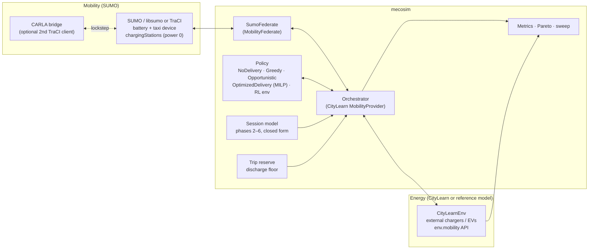

# Architecture

## Packages

| Package | Contents |
|---|---|
| `mecosim.core` | `Clock` (master step = energy step, mobility sub-steps), entities (`Zone`, `Hub`, `VehicleSpec`, `VehicleState`, `EnergySession`), `SessionModel` (phases 2–6, closed-form energy and inverse), reserve (`trip_reserve_soc`, `delivery_floor`, `ConsumptionEstimator`), `planning.estimate_stop`, `Orchestrator`, protocols (`MobilityFederate`, `EnergyBackend`, `EnergyDriver`, `Policy`, commands), `EventLog` |
| `mecosim.adapters.sumo` | `SumoFederate` (libsumo or TraCI; multi-client with `setOrder`; battery device; taxi device with `dispatch-algorithm traci`; energy stops; stock-SUMO taxi choreography; optional native V2G fast path), connection helpers, capability detection |
| `mecosim.adapters.citylearn` | dataset window resampling, schema patching (zones, PV scaling, one external charger per hub plug, external fleet EVs), `CityLearnBackend` (wraps `env.mobility`), `CityLearnDriver` (actions from energy targets, KPIs) |
| `mecosim.adapters.carla` | commands for CARLA's `run_synchronization.py`, `CarlaAwareSumoFederate` |
| `mecosim.energy` | `ReferenceEnergyModel`: a small energy backend with the same contract, for tests and runs without CityLearn |
| `mecosim.policies` | `BasePolicy` (greedy passenger dispatch + low-SOC recharge, shared by all), `NoDelivery`, `GreedyDeficitDispatch`, `OpportunisticMidJourney`, `RandomDispatch`, `OptimizedDelivery` |
| `mecosim.envs` | Gymnasium `MecosimEnv` (central), PettingZoo `MecosimParallelEnv` (one agent per vehicle) |
| `mecosim.metrics` | mobility metrics from SUMO tripinfo/statistics and session records; Pareto sets (pymoo non-dominated sorting); welfare with explicit weights |
| `mecosim.scenarios` | pydantic/YAML `ScenarioSpec`; `build_scenario` (netgenerate, randomTrips.py, charging stations, fleet) |
| `mecosim.mosaik` | `MecosimSim`, a time-based mosaik simulator |
| `mecosim.cli`, `mecosim.sweep`, `mecosim.runner` | `mecosim run`, `mecosim sweep`, `mecosim build`, `mecosim info` |

## Time coupling and call order

The energy step is the master step (60 s in the demo). CityLearn calls the orchestrator:

1. `env.reset()` → `Orchestrator.reset(env)`: start SUMO, reset the policy, then *interval 0*.
2. `env.step(actions)` computes the energy of interval `t`, advances to `t + 1` and calls
   `Orchestrator.update(env, t + 1)`:
   1. **reconcile**: battery energy CityLearn transferred in interval `t` → `device.battery.chargeLevel += ΔE`;
   2. **decide**: the policy runs at the start of the interval (and at extra decision epochs if
      `decision_period_s < master_step_s`), commands are applied (`dispatchTaxi`, energy stops);
   3. **advance**: SUMO steps through the interval one step at a time; stop starts/ends of fleet vehicles are recorded
      with the step's time;
   4. **write**: for every hub plug, `connect` (with `connected_seconds`, arrival SOC for a new session,
      `departure_steps`, `discharge_soc_floor`), `incoming` or `away`; `set_vehicle_soc` for all other fleet vehicles.
3. The driver turns the orchestrator's per-charger targets into CityLearn actions for the next `env.step`: with
   `timing_owner="energy_model"` (default when CityLearn has charger session dynamics) a constant set-point that
   CityLearn shapes with start delay, set-point delay, ramps and stop delay; with `timing_owner="mecosim"` the
   interval energy of mecosim's session profile as an average power over the connected seconds.

Mobility therefore leads energy by one interval: arrivals and departures inside an interval are known before its
energy is computed, and energy is integrated exactly over the connected part of the interval.

## Protocols (extension points)

- `MobilityFederate`: `start`, `close`, `advance(until_s) -> events`, `vehicle_state`, `open_requests`, `dispatch`,
  `energy_stop`, `set_stop_duration`, `end_stop`, `adjust_battery_kwh`, `set_soc`, `route`. Optional:
  `schedule_stop_end`, `has_planned_stop`, `is_idle`, `taxi_keeps_energy_stops`, native V2G hooks.
- `EnergyBackend`: `connect`, `incoming`, `away`, `set_vehicle_soc`, `vehicle_soc`, `charger_energy_kwh`,
  `zone_state`; optional `efficiency(charger, ev, power, direction)`.
- `EnergyDriver`: `reset(provider)`, `step(targets) -> done`, `kpis()`, `n_steps`.
- `Policy`: `reset(context)`, `decide(observation) -> commands`.

`MobilityFederate` has two implementations: `SumoFederate` and the pure-Python `SurrogateFederate` (selected with
`simulation.fidelity`; see [fidelity.md](fidelity.md)). See `docs/extending.md` for adding a simulator or a policy.

## Outputs of a run

`metrics.json` (energy, mobility, battery and welfare metrics), `sessions.csv` (one row per energy session: planned and
measured energies, arrival/departure, floor, passengers), `events.jsonl` (dispatches, energy stops, re-insertions,
session start/end, per-interval energies), and SUMO's `tripinfo.xml`, `statistics.xml`, `stops.xml`, `sumo.log`.
