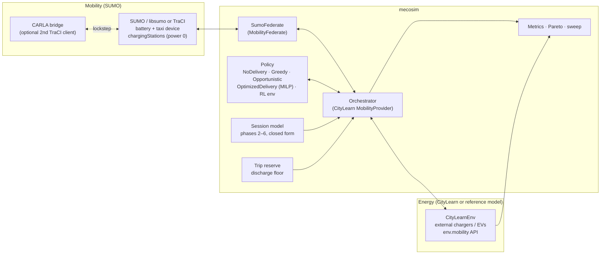

# Architecture

## Packages

| Package | Contents |
|---|---|
| `mecosim.core` | `Clock` (master step = energy step, mobility sub-steps), entities (`Zone`, `Hub`, `VehicleSpec`, `VehicleState`, `EnergySession`), `SessionModel` (phases 2–6, closed-form energy and inverse), reserve (`trip_reserve_soc`, `delivery_floor`, `ConsumptionEstimator`), `planning.estimate_stop`, `Orchestrator`, protocols (`MobilityFederate`, `EnergyBackend`, `EnergyDriver`, `Policy`, commands), `EventLog` |
| `mecosim.adapters.sumo` | `SumoFederate` (libsumo or TraCI; multi-client with `setOrder`; battery device; taxi device with `dispatch-algorithm traci`; energy stops; stock-SUMO taxi choreography; optional native V2G fast path), connection helpers, capability detection; warm-state `rewind`, meso mode |
| `mecosim.adapters.citylearn` | dataset window resampling, schema patching (zones, PV scaling, one external charger per hub plug, external fleet EVs), `CityLearnBackend` (wraps `env.mobility`), `CityLearnDriver` (actions from energy targets, KPIs) |
| `mecosim.adapters.carla` | commands for CARLA's `run_synchronization.py`, `CarlaAwareSumoFederate` |
| `mecosim.energy` | `ReferenceEnergyModel`: a small energy backend with the same contract, for tests and runs without CityLearn |
| `mecosim.policies` | `BasePolicy` (greedy passenger dispatch + low-SOC recharge, shared by all), `NoDelivery`, `GreedyDeficitDispatch`, `OpportunisticMidJourney`, `RandomDispatch`, `OptimizedDelivery` |
| `mecosim.envs` | Gymnasium `MecosimEnv` (central; fast reset, control step, event decisions), PettingZoo `MecosimParallelEnv` (one agent per vehicle), `make_vector_env` (one process per environment), RLlib env creator |
| `mecosim.metrics` | mobility metrics from SUMO tripinfo/statistics and session records; Pareto sets (pymoo non-dominated sorting); welfare with explicit weights |
| `mecosim.scenarios` | pydantic/YAML `ScenarioSpec`; `build_scenario` (netgenerate, randomTrips.py, charging stations, fleet) |
| `mecosim.mosaik` | `MecosimSim`, a time-based mosaik simulator |
| `mecosim.cli`, `mecosim.sweep`, `mecosim.runner` | `mecosim run`, `mecosim sweep`, `mecosim build`, `mecosim info` |

## Time coupling and call order

The energy step is the master step (60 s in the demo). CityLearn calls the orchestrator:

1. `env.reset()` → `Orchestrator.reset(env)`: start SUMO, reset the policy, then *interval 0*.
2. `env.step(actions)` computes the energy of interval `t`, advances to `t + 1` and calls
   `Orchestrator.update(env, t + 1)`:
   1. **reconcile**: battery energy CityLearn transferred in interval `t` → `device.battery.chargeLevel += ΔE`;
   2. **decide**: the policy runs at the start of the interval (and at extra decision epochs if
      `decision_period_s < master_step_s`), commands are applied (`dispatchTaxi`, energy stops);
   3. **advance**: SUMO steps through the interval one step at a time; stop starts/ends of fleet vehicles are recorded
      with the step's time;
   4. **write**: for every hub plug, `connect` (with `connected_seconds`, arrival SOC for a new session,
      `departure_steps`, `discharge_soc_floor`), `incoming` or `away`; `set_vehicle_soc` for all other fleet vehicles.
3. The driver turns the orchestrator's per-charger targets into CityLearn actions for the next `env.step`: with
   `timing_owner="energy_model"` (default when CityLearn has charger session dynamics) a constant set-point that
   CityLearn shapes with start delay, set-point delay, ramps and stop delay; with `timing_owner="mecosim"` the
   interval energy of mecosim's session profile as an average power over the connected seconds.

Mobility therefore leads energy by one interval: arrivals and departures inside an interval are known before its
energy is computed, and energy is integrated exactly over the connected part of the interval.

## Training throughput (opt-in)

All switches default to the previous behaviour. Measured numbers: README, section "Training speed";
`benchmarks/rl_throughput.py` reproduces them.

**Fast reset** (`MecosimEnv(fast_reset=True)`, `OrchestratorConfig.rewind_on_reset`). The environment keeps the energy
driver (the CityLearn environment is built once, `env.reset()` is CityLearn's own), the orchestrator and the SUMO
process. `reset` calls `SumoFederate.rewind()`: an in-process SUMO reload (`libsumo.load` / `traci.load`) instead of
closing and starting SUMO, and clears the federate's and the orchestrator's episode state (sessions, event log, route
cache, consumption estimates). With `simulation.warmup_s > 0` the background traffic runs alone from `begin_s`; fleet
and ride requests start at `begin_s + warmup_s`. The first reset advances to that time, saves the state
(`simulation.saveState`, binary `.sbx`) and reloads it; later resets reload with `--load-state`. `simulation.loadState`
is not used: SUMO 1.28 drops the persons and vehicles of the route files that have not departed yet, so the ride
requests would be lost. The SUMO RNG is not part of the state, so every episode, the first included, starts from the
reloaded state. `simulation.start_offset_max_s` adds a random delay (drawn per episode from the env's seed) between
the warm-up and master step 0; ride requests accumulate during it. The demand is generated for
`duration_s + start_offset_max_s`. `build_scenario_cached(spec, cache_dir)` keys the generated files by
`scenario_hash(spec)` (energy, session, reserve, `profile` and `mode` are not part of it).

**Training profile** (`simulation.profile: train`). No tripinfo, statistics, stop output or SUMO log; `--no-warnings`.
`MecosimEnv` rewards and observations use the orchestrator's sessions and the energy driver, so they are unchanged.
`run_scenario` reports `persons_completed` and `throughput_trips_per_h` from the federate and NaN for the metrics that
need tripinfo (`mean_person_wait_s`, `mean_person_travel_time_s`, `mean_ride_time_s`, `background_*`,
`passenger_delay_per_trip_s`). Rejected because they change results: `--routing-algorithm astar` (different tie-breaking
in taxi routes) and `--no-internal-links` (different junction dynamics). `--xml-validation never` and
`--device.rerouting.probability 0` gave identical results and no measurable gain.

**Semi-MDP control** (`MecosimEnv(control_step_s=..., decision="fixed"|"event")`). `control_step_s` overrides
`simulation.master_step_s` (CityLearn's step; 900 and 3600 work because CityLearn integrates the sub-step timing through
`connected_seconds` and `departure_seconds`). With `decision="event"` the orchestrator splits each master interval
into decision epochs (`OrchestratorConfig.decision_mode="event"`, `Orchestrator.advance_epoch`): an epoch ends at the
first mobility step that produced a fleet stop start or end, a passenger arrival or a new open ride request, or at the
end of the master interval. An environment step is one epoch; `info["dt_s"]` is its mobility duration for
`gamma ** (dt_s / dt_ref)` discounting. The energy step (CityLearn) still runs once per master interval, so energy
terms of the reward arrive in the step that closes the interval. Vehicle idle transitions without a stop event are not
epochs. Event decisions need `energy.backend: reference`: CityLearn accepts charger writes only inside its mobility
callbacks, so it cannot be paused mid-interval (the environment raises `ValueError`).

**Vectorised environments** (`mecosim.envs.make_vector_env(scenario, n_envs, seed)`). gymnasium's `AsyncVectorEnv` with
the spawn context, one libsumo and one energy driver per process, per-worker directories, seeds (`seed + i`) and SUMO
`--seed`. `rllib_env_creator` / `register_rllib_env` give the same per-worker setup for RLlib (imported only on use).

**Meso mode** (`simulation.mode: meso`, `--mesosim`). `vehicle.isStopped` calls `getStopState`, which meso does not
implement (warning, wrong value); the federate reads the stop list instead (`arrival >= 0` and not departed). `resume`
is not implemented in meso either (warning): an energy stop then ends at its planned duration or when SUMO ends it, not
earlier. Some SUMO builds remove fleet taxis in meso mode ("Vehicle 'av1' is not known"); the federate raises
`FleetVehicleLostError` when a fleet vehicle disappears. Meso tests are marked xfail on such builds.

**Where SUMO-side time goes** (cProfile of the two-zone demo, 1800 s, reference energy): 0.53 s of 0.57 s spent in
`advance` is `simulation_step` inside SUMO. All TraCI getters of the observation (about 18 microseconds per vehicle) and the
per-step event queries add up to roughly 0.04 s per episode. TraCI subscriptions would save less than 0.1 ms per
step, and `simulationStep(until)` cannot detect events inside the jump, so neither is implemented.

## Protocols (extension points)

- `MobilityFederate`: `start`, `close`, `advance(until_s) -> events`, `vehicle_state`, `open_requests`, `dispatch`,
  `energy_stop`, `set_stop_duration`, `end_stop`, `adjust_battery_kwh`, `set_soc`, `route`. Optional:
  `schedule_stop_end`, `has_planned_stop`, `is_idle`, `taxi_keeps_energy_stops`, native V2G hooks.
- `EnergyBackend`: `connect`, `incoming`, `away`, `set_vehicle_soc`, `vehicle_soc`, `charger_energy_kwh`,
  `zone_state`; optional `efficiency(charger, ev, power, direction)`.
- `EnergyDriver`: `reset(provider)`, `step(targets) -> done`, `kpis()`, `n_steps`.
- `Policy`: `reset(context)`, `decide(observation) -> commands`.

See `docs/extending.md` for adding a simulator or a policy.

## Outputs of a run

`metrics.json` (energy, mobility, battery and welfare metrics), `sessions.csv` (one row per energy session: planned and
measured energies, arrival/departure, floor, passengers), `events.jsonl` (dispatches, energy stops, re-insertions,
session start/end, per-interval energies), and SUMO's `tripinfo.xml`, `statistics.xml`, `stops.xml`, `sumo.log`.
